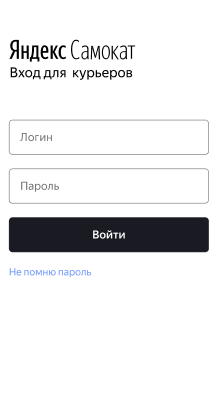

## 🛴 Работа над экосистемой Яндекс.Самокат

<b>Яндекс.Самокат</b> - веб-приложения, которое позволяет арендовать электрический самокат на несколько дней. 

В ходе работы над веб-приложением Яндекс.Самокат я:  
1. разработала mindmap для форм заказа самоката: ["Для кого самокат"](https://miro.com/app/board/uXjVP4tUP2w=/) и ["Про аренду"](https://miro.com/app/board/uXjVP482iUg=/).
2. составила чек-лист по требованиям к экрану ["Статуc заказа"](https://docs.google.com/spreadsheets/d/1GxOeOnGcTwxdxCw4Mq99d2w1FJVJa8LJpcjxiWcW8VA/edit?usp=sharing).
3. составила проверки на валидацию полей для экрана ["Сделать заказ](https://docs.google.com/spreadsheets/d/1GxOeOnGcTwxdxCw4Mq99d2w1FJVJa8LJpcjxiWcW8VA/edit?usp=sharing).
4. провела тестирования всей функциональности по требованиям и макетам. 

<b>Яндекс.Самокат</b> - мобильное приложения для курьеров. 

В ходе работы над веб-приложением Яндекс.Самокат я:
1. спроектировала [тест-кейсы](https://docs.google.com/spreadsheets/d/1GxOeOnGcTwxdxCw4Mq99d2w1FJVJa8LJpcjxiWcW8VA/edit?usp=sharing) по требованиям к нотификации и отсутствию интернет-соединения и протестировала эту функциональность. Оформила баг-репорты.
2. разработала [чек-лист](https://docs.google.com/spreadsheets/d/1GxOeOnGcTwxdxCw4Mq99d2w1FJVJa8LJpcjxiWcW8VA/edit?usp=sharing) и протестировала API. Оформила баг-репорты.
